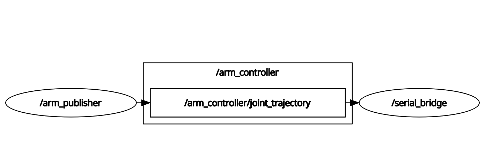
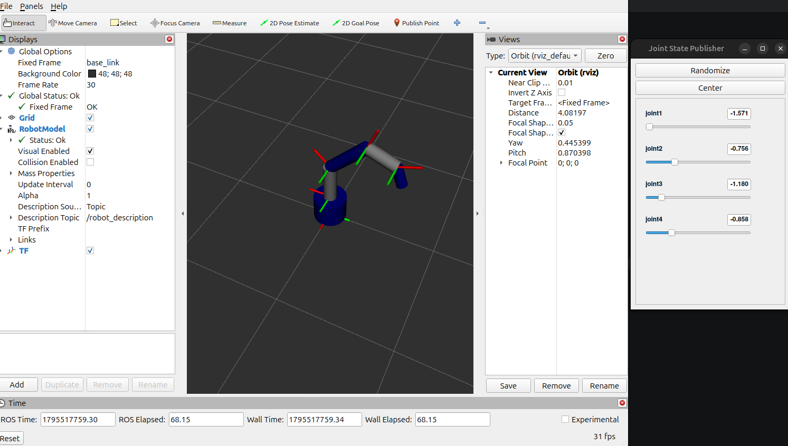
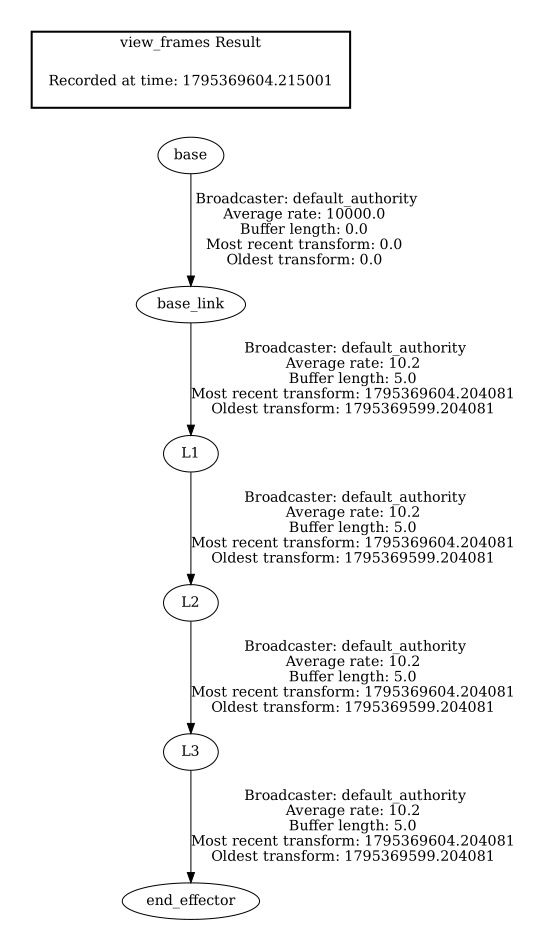
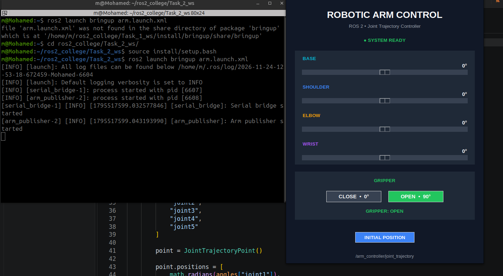

# Design Lab 2 — ROS 2 Robotic Arm

A ROS 2 manual-control project for a 5-servo robotic arm. The arm's four modeled joints are visualized in RViz, while a Tkinter GUI publishes joint trajectory commands that a serial bridge converts into a simple CSV command for an ESP32 and PCA9685 servo driver.

> **Scope:** The gripper is controlled as a fifth servo in the GUI, serial protocol, and microcontroller firmware. It is intentionally not modeled as a joint in the current URDF. Gazebo setup is present in the repository but is not covered by these instructions.

## Project structure

```
.
├── Frimware/
│   └── Frimware.ino           # ESP32 firmware (PCA9685 servo control)
├── bringup/
│   ├── config/
│   ├── launch/
│   └── package.xml
├── description/
│   ├── urdf/                 # Xacro robot model and properties
│   ├── rviz/
│   └── package.xml
├── my_pkg/
│   └── my_pkg/
│       ├── gui.py             # Tkinter control panel
│       ├── publisher.py       # ROS 2 JointTrajectory publisher
│       ├── serial_bridge.py   # ROS 2 to serial bridge
│       └── test_arm_serial.py # Serial test utility
└── media/
    ├── gui.png
    ├── rviz.png
    └── tf_tree.png
```

## System architecture

The GUI sends all joint values through the same ROS 2 trajectory topic. The serial bridge listens to that topic, converts joint values into servo angles, and sends a CSV line to the ESP32.


### ROS node graph

The ROS node graph as viewed in RQT:



## Robot visualization

The URDF/Xacro model currently contains four revolute joints: base, shoulder, elbow, and wrist. Links include visual, collision, and inertial descriptions. The gripper is not included in this model.



### TF tree



## GUI controller

The Tkinter GUI provides sliders for the four modeled arm joints and buttons to open or close the gripper. Joint slider values are in degrees; the ROS publisher converts them to radians for `JointTrajectory`.



## Hardware and communication

### Hardware

- ESP32 (serial-connected to the ROS 2 computer)
- PCA9685 16-channel PWM servo driver, I2C address `0x40`
- 5 servos: base, shoulder, elbow, wrist, and gripper
- External servo power supply sized for the servos
- Common ground between ESP32, PCA9685, and servo supply

### PCA9685 channel mapping

| Servo | PCA9685 channel |
|---|---:|
| Base | 0 |
| Shoulder | 1 |
| Elbow | 2 |
| Wrist | 3 |
| Gripper | 4 |

The firmware uses ESP32 I2C pins SDA = GPIO 21 and SCL = GPIO 22, with the PCA9685 PWM frequency set to 50 Hz. Servo pulse values are configured in the firmware as `SERVO_MIN = 110` and `SERVO_MAX = 500`.

**Power note:** Do not power the servos from the ESP32's 5 V pin. Use a suitable external servo supply and connect the grounds together. Confirm supply voltage and current capacity for your servo models.

### Serial protocol

The serial bridge sends one newline-terminated CSV command at 115200 baud:

```
base,shoulder,elbow,wrist,gripper
```

Example command:

```
90,90,90,90,0
```

The values are servo angles in degrees. The bridge maps arm joint angles (radians received in ROS) to servo degrees by applying a 90-degree center offset for the arm joints; the gripper is mapped directly to 0–90 degrees. Firmware applies its own safety limits and moves toward target positions in 1-degree steps at 20 ms intervals.

Current firmware angle constraints:

| Servo | Firmware range |
|---|---:|
| Base | 30–150° |
| Shoulder | 60–120° |
| Elbow | 45–135° |
| Wrist | 45–135° |
| Gripper | 0–90° |

## Software requirements

- ROS 2 (with the environment sourced)
- Python 3
- Tkinter
- pySerial
- `trajectory_msgs`

On Ubuntu, install the system dependencies (replace `$ROS_DISTRO` with your installed ROS 2 distribution if needed):

```bash
sudo apt update
sudo apt install python3-tk python3-serial ros-$ROS_DISTRO-trajectory-msgs
```

## Build

Clone the repository into your ROS 2 workspace's `src` directory:

```bash
mkdir -p ~/ros2_ws/src
cd ~/ros2_ws/src
git clone https://github.com/mohamed1293128-sketch/Design-Lab-2-ROS2-Assignment.git
cd ~/ros2_ws
source /opt/ros/$ROS_DISTRO/setup.bash
colcon build
source install/setup.bash
```

The repository contains three ROS packages: `description`, `bringup`, and `my_pkg`.

## Running

### 1. Start RViz robot visualization

In a terminal sourced with ROS 2 and the workspace:

```bash
ros2 launch bringup display.launch.xml
```

The current display launch starts `robot_state_publisher`, `joint_state_publisher_gui`, and RViz. The joint-state GUI is separate from the trajectory-control GUI.

### 2. Flash the ESP32

1. Open `Frimware/Frimware.ino` in Arduino IDE.
2. Install the **Adafruit PWM Servo Driver Library** if it is not already installed.
3. Select your ESP32 board and port, then upload.
4. Connect the ESP32 to the ROS computer by USB and check which serial device it appears as (the bridge currently uses `/dev/ttyUSB0`).

### 3. Launch hardware control

```bash
ros2 launch bringup arm.launch.xml
```

This launch starts:
- `arm_publisher`: GUI and trajectory publisher
- `serial_bridge`: converts trajectory commands to CSV serial commands

If your serial device is not `/dev/ttyUSB0`, update the port in `my_pkg/my_pkg/serial_bridge.py`. If access is denied, ensure your user has serial-port permissions (commonly the `dialout` group on Ubuntu), then log out and back in after changing group membership.

## Topic

The GUI publisher and bridge use:

```
/arm_controller/joint_trajectory
```

Message type:

```
trajectory_msgs/msg/JointTrajectory
```

## Notes / current limitations

- The hardware control path is GUI → ROS 2 trajectory topic → serial bridge → ESP32 → PCA9685 → servos.
- The gripper is the fifth servo command in the hardware protocol, but it is intentionally omitted from the current URDF model.
- The RViz joint-state GUI currently operates independently; it is not driven by the hardware trajectory topic or servo feedback.
- The serial device path is currently hard-coded in the bridge.
- Gazebo simulation instructions are not included here.

## License

This project is licensed under the [MIT License](LICENSE). See the `LICENSE` file for the full license text.
